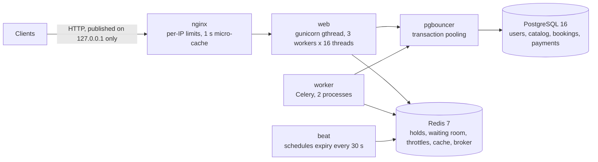
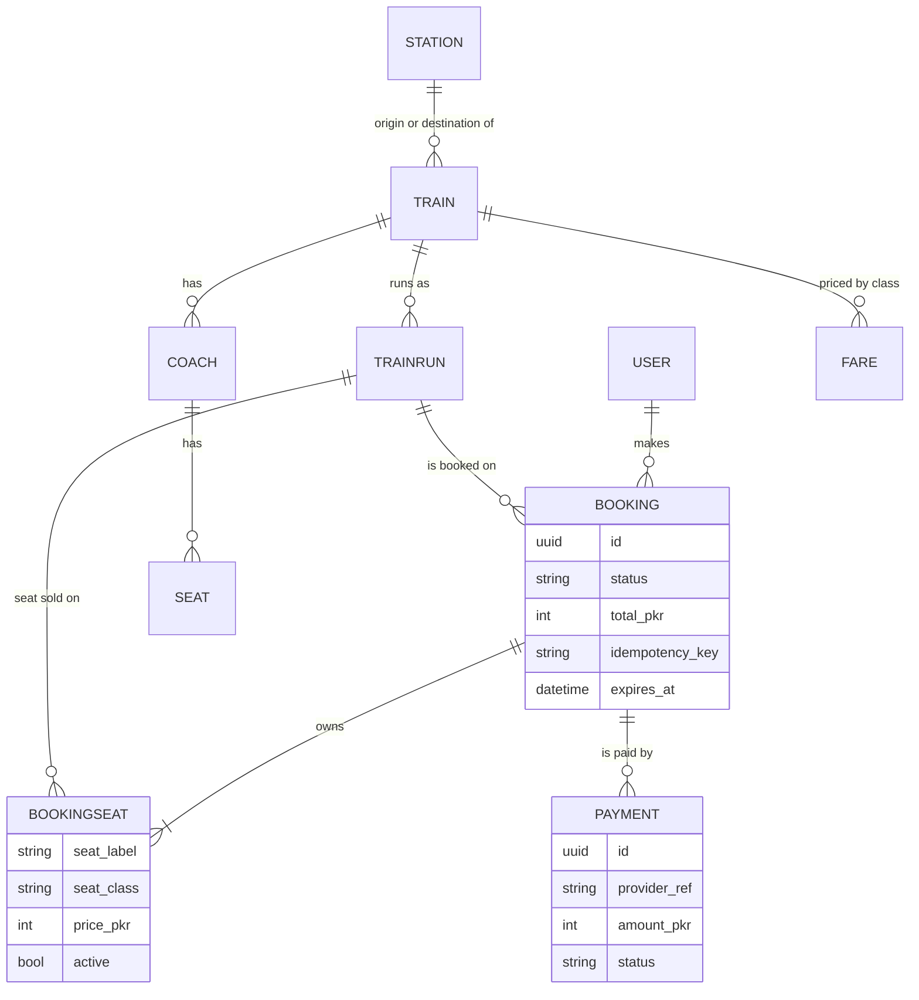
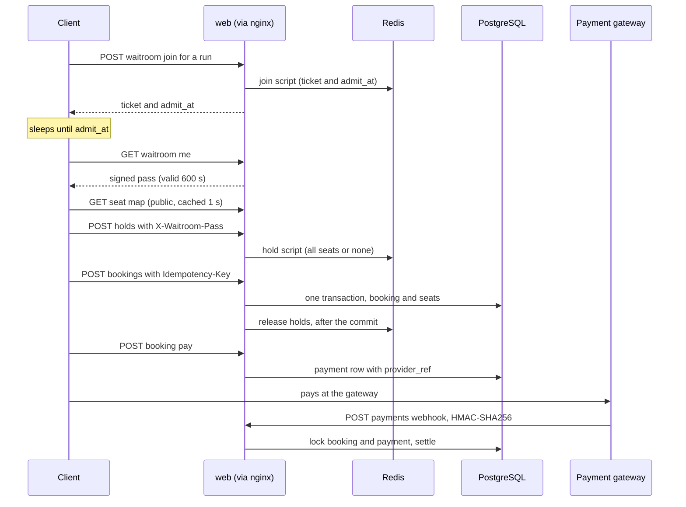
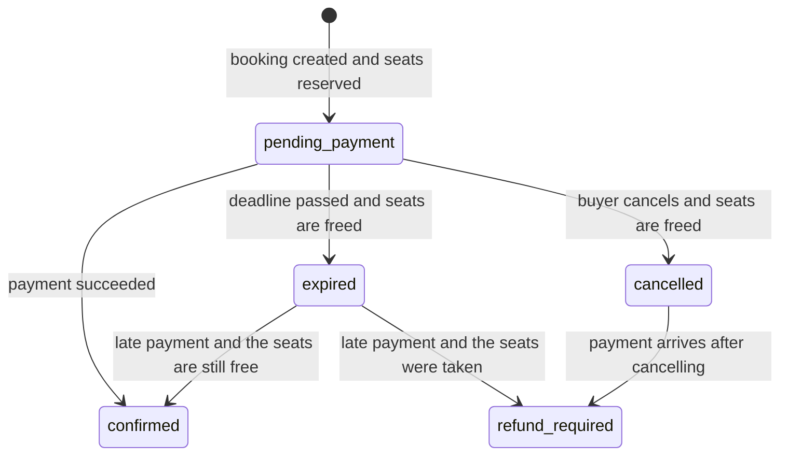
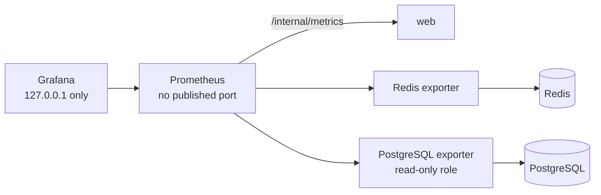

# RailRush architecture

RailRush is a Django backend for Eid-rush train ticket booking. Two goals drive every design choice: a seat is never
sold twice, and the system survives the minutes when booking opens (target: 35,000 people at once) on limited
hardware.

How to read this document: it describes the system as it is in the repository (Phase 8 complete). Each section says
where its facts come from. Reasons for the big decisions are in the ADRs (`docs/adr/`), measured numbers are in
`docs/CAPACITY.md`, and operating procedures are in `docs/RUNBOOK.md`. Things that are not built or not verified are
listed in "Known gaps" at the end.

## 1. The system at a glance

Containers (`docker-compose.yml`):

| Service | What it is | Memory limit |
|---|---|---|
| nginx | The only service published to the host, on `127.0.0.1:${NGINX_HOST_PORT}` | 256 MB |
| web | Django + DRF under gunicorn (`gthread`, 3 workers x 16 threads), stateless JWT | 1.5 GB |
| pgbouncer | Connection pooler in front of PostgreSQL (ADR 0004) | 128 MB |
| postgres | PostgreSQL 16, source of truth for users, catalog, bookings and payments | 1.5 GB |
| redis | Redis 7, `noeviction`, append-only file synced every second (ADR 0001) | 1 GB (maxmemory 768 MB) |
| worker | Celery worker, 2 processes | 512 MB |
| beat | Celery beat, exactly one copy, runs the expiry task every 30 s | 256 MB |
| migrate | One-shot: applies migrations straight to PostgreSQL before web starts | 512 MB |
| test | Profile `test` only: the test suite against real PostgreSQL and Redis | none set |

Networks: `edge` (nginx, Grafana) is the only one with a route out. `backend` is internal, with no route to the
internet. `monitor` is internal and holds the observability stack. All containers run with `no-new-privileges`.
Every container except postgres drops all Linux capabilities. web, worker, beat, redis, migrate and nginx also have a
read-only root filesystem with tmpfs for `/tmp`.

## 2. The edge: what nginx does before Django sees a request

From `deploy/nginx/nginx.conf`:

- **Per-IP limits**, deliberately generous because mobile carriers put thousands of people behind one address: 100
  requests per second with a burst of 200, and 300 connections per IP. Login and sign-up (`/api/auth/`) also have a
  strict zone of 5 per second with a burst of 10.
- **A 1-second micro-cache** for the public read endpoints: `/api/catalog/...` and `/api/waitroom/<run>/status/`.
  Requests that carry an `Authorization` header or a cookie are never cached or served from the cache, and a stale
  copy is served while the cache refreshes or when the upstream fails.
- **`/internal/` answers 404.** Metrics are never public. `/api/health/ready/` is allowed from private networks only.
- **`X-Forwarded-For` is overwritten** with the real peer address, so a client cannot forge it. Django trusts exactly
  one proxy (`NUM_PROXIES=1`), so throttles see the real client address.
- Errors that nginx makes itself (403, 429, 502 to 504) use the same JSON envelope as the API.
- Small bodies (64 KB), short timeouts and a method allow-list limit slow-client attacks.
- There is **no global in-flight cap**: it was tried and rejected (ADR 0008).

App-level throttles are one Redis call each (ADR 0006). Default rates, all overridable with `THROTTLE_*`
environment variables: anonymous 60 per minute, signed-in user 300, login 10, register 5, token refresh 120,
waiting-room join 20, waiting-room "me" 120, hold 30, booking 20, payment webhook 600.

## 3. Where state lives

| State | Where | Notes |
|---|---|---|
| Users, stations, trains, coaches, fares, runs | PostgreSQL | Catalog is read-mostly |
| Bookings, booked seats, payments | PostgreSQL | The source of truth. A seat is sold only here |
| Seat holds (300 s) | Redis, `hold:{run}:...` | Atomic Lua scripts (ADR 0001) |
| Waiting-room queue and tickets | Redis, `wr:{run}:...` | Leaky-bucket scheduler (ADR 0002) |
| Throttle counters | Redis, `thr:...` | One small counter per key, expires after one window |
| Run schedule and coach layout cache | Django cache (Redis), 30 to 60 s | `wr:runinfo:<run>`, `bk:layout:<run>` |
| Celery broker | Redis, database 1 | |
| Waiting-room pass | Nowhere | Signed token, verified without any lookup |

Redis holds, queues and counters can be lost in a crash (about one second of data with the append-only file). That
costs buyers their place or a hold, never a double sale, because PostgreSQL has the last word.

## 4. Data model

Facts that matter (`apps/bookings/models.py`, `apps/catalog/models.py`):

- Prices are whole Pakistani rupees, from `catalog.Fare`. They are read on the server and never taken from the client.
- A seat is named `<coach>-<row><letter>`, for example `3-12C`. Names are checked against the train's coach layout, so
  holding a seat reads no seat table. The `Seat` table exists in the catalog; the booking path does not read it.
- `BookingSeat` has a **partial unique index** on `(run, seat_label)` where `active` is true
  (`uniq_active_seat_per_run`). It is the hard guard against selling a seat twice.
- `Booking` is unique per `(user, idempotency_key)`. `Payment.provider_ref` is unique.
- Database check constraints keep totals, prices and amounts above zero, and keep run times in order.
- With stateless JWT, `request.user` is a `TokenUser`, not a `User` row. Booking code therefore always filters on
  `user_id`.

## 5. One purchase, step by step

1. **Join the queue.** Joining is one atomic Lua script. The answer carries `admit_at`; the client sleeps until then
   instead of polling. The rate is `WAITROOM_ADMIT_PER_SECOND` per run.
2. **Get a pass.** Once admitted, `me` returns a signed pass tied to one user and one run. A pass is needed to hold seats.
3. **Hold seats.** Up to 4 seats per user, for 300 seconds. All seats of a request are taken or none are.
4. **Book.** `POST /api/bookings/` with an `Idempotency-Key` header books all of the user's live holds. The server
   prices the seats, then writes the booking and its seats in one transaction. A booking now reserves its seats in
   PostgreSQL for `BOOKING_PAYMENT_SECONDS` (600). Only after the commit are the Redis holds released.
5. **Pay.** `POST .../pay/` opens (or reuses) a payment with a gateway reference. Only a mock gateway exists.
6. **Webhook.** The gateway calls `POST /api/payments/webhook/`. The body is authenticated with HMAC-SHA256 in the
   `X-Gateway-Signature` header. Without `PAYMENT_WEBHOOK_SECRET`, every webhook is refused. Events are applied under
   row locks, booking first and payment second, so two requests cannot deadlock on them.
7. **Expiry.** Celery beat runs `expire_pending_bookings` every 30 seconds. Rows are locked with `skip_locked`, so two
   runs at once are safe.

## 6. Booking states

- A payment event is applied once: a repeated event for a settled payment is ignored.
- A second successful payment for an already confirmed booking leaves it confirmed and is logged as
  `payments.duplicate_charge`.
- A payment with the wrong amount is marked failed and logged as `payments.amount_mismatch`; the booking is untouched.
- `refund_required` needs a manual refund. There is no refund flow and no `refunded` state yet (see the runbook).
- `confirmed` and `refund_required` bookings are never expired by the background task. Only unpaid bookings expire.

## 7. How a double sale is prevented

From the fastest, least certain gate to the hardest:

1. **Waiting room:** the pass and the admission pace limit how many people reach the hold step at once.
2. **Redis hold script:** two users can never hold the same seat, and one user can never pass the per-user limit.
3. **A booking needs live holds:** `create_booking` reads the user's own holds and prices from the catalog.
4. **PostgreSQL partial unique index:** even if all of Redis is lost, a seat cannot become active in two bookings. A
   seat that was sold in the meantime raises an integrity error, which the API answers with a conflict.
5. **Idempotency:** the same key replays the same booking, and a key reused for another run is refused.
6. **Late payment:** an expired booking is revived only if its seats can be made active again; otherwise it becomes
   `refund_required`, never a second owner of the seat.

The load tests (about 6,700 journeys in 21 runs, `docs/CAPACITY.md`) checked after each run that no seat was sold
twice and every confirmed booking had exactly one succeeded payment of the same amount.

## 8. Observability

Started with `docker-compose.observability.yml` next to the main file (ADR 0007). It has 13 alert rules with
`promtool` unit tests, a provisioned dashboard, and no Alertmanager.

## 9. Security posture

- Stateless JWT (15-minute access tokens, 1-day refresh tokens). Waiting-room passes use their own signing salt, so a
  token of another kind is never accepted as a pass.
- Production settings fail closed: a missing allowed-hosts value stops startup; HSTS and secure cookies are on.
- Webhooks fail closed without their secret, and the signature check is constant-time.
- Other people's bookings answer 404, the same as a booking that does not exist.
- `/internal/metrics` refuses any request that came through nginx.
- Logs record paths only, never query strings.
- The security gate (`scripts/security-check.ps1`) runs lint, bandit, a dependency audit, a secrets scan, Django
  checks (including `check --deploy` with production settings), a migration-drift check and the tests.

## 10. What happens when something breaks

Only behaviour that is visible in the code or configuration is listed here.

- **Redis memory is full:** writes fail instead of evicting (`noeviction`). Alert `RedisMemoryHigh` fires at 80%.
- **Throttle store unreachable:** throttled endpoints answer 503 with a retry hint (ADR 0006).
- **Readiness** (`/api/health/ready/`) checks the database and Redis and is cached for 2 seconds; liveness touches nothing.
- **The database pool is exhausted:** a request waits up to 10 seconds in PgBouncer and then errors. The API does not
  yet turn that into a 503.
- **beat or worker is down:** unpaid bookings stop expiring, so their seats stay reserved. Starting a payment after
  the deadline is refused, but a payment already in flight can still confirm a booking that is still marked
  `pending_payment`. Alert `ExpiryStalled` fires.
- **After recreating `web`:** restart nginx, because it keeps the old upstream address.

## 11. Capacity in one paragraph

On the test laptop (2 cores, a slow and noisy machine) serving one user costs about 0.3 core-seconds per benchmark
second, about 70% of it in web. The default of 50 admissions per second per run is about 8 times what that rig
sustained for one hot train, so the admission rate must be sized for the real hardware with the formula in
`docs/CAPACITY.md`. These numbers come from bursts of 400 users, not from a long soak.

## 12. Known gaps

- No soak test of 30 minutes or more on production-like hardware.
- About 4 ms of CPU per request inside Django alone against 24 to 58 ms under gunicorn load is unexplained.
- Dependencies use version ranges and there is no lock file with hashes. Base images are pinned by tag, not digest.
- The admission rate needs a web restart to change, and affects only people who join afterwards.
- Only a mock payment gateway exists. There is no refund flow and no admin screens for bookings and payments.
- No Alertmanager, no nginx metrics, no per-container metrics.
- No production TLS setup is included (the local stack is plain HTTP; `SECURE_SSL_REDIRECT` is an override).
- Pool exhaustion is not mapped to 503. Entry-only load shedding is untested.
- This document does not describe how the hold and waiting-room endpoints answer when Redis is unreachable. That
  behaviour has not been recorded here and should be tested and added.
- Unmatched URLs still return Django's default 404 page instead of the JSON error envelope.

## 13. Decision records

| ADR | Decision |
|---|---|
| 0001 | Seat holds in Redis behind atomic Lua scripts |
| 0002 | Virtual waiting room: leaky-bucket queue per run, signed passes |
| 0003 | Threaded WSGI (gunicorn gthread), not ASGI |
| 0004 | PostgreSQL behind PgBouncer in transaction-pooling mode |
| 0005 | The database reserves seats while a booking is being paid |
| 0006 | One-call Redis fixed-window throttles |
| 0007 | Prometheus, Grafana and two exporters for observability |
| 0008 | No uniform nginx in-flight cap (rejected) |